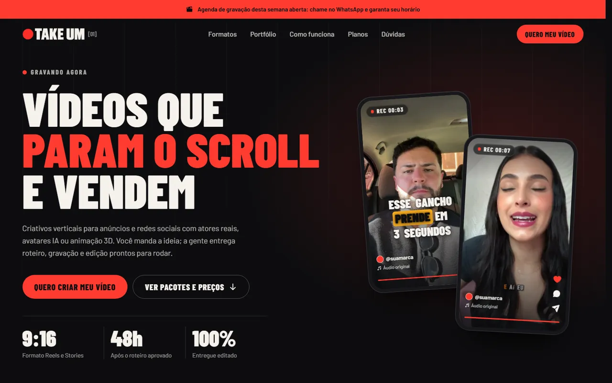

<div align="center">

# Take Um

**Landing page de vendas de uma produtora de vídeos verticais 9:16 para anúncios e redes sociais.**

[](https://take-01.vercel.app)


</div>

<p align="center">
  
  
</p>

## Sobre

A Take Um produz criativos verticais (Reels, Stories, TikTok, Meta Ads) em três formatos: atores reais,
avatar com IA e animação 3D. A página apresenta os formatos, mostra o portfólio em vídeo, explica o
processo e leva o visitante a escolher um pacote, pagando pelo checkout ou chamando no WhatsApp.

O visual segue a linguagem de um set de gravação: ponto vermelho de REC, timecode correndo,
cantoneiras de visor de câmera e legendas no estilo dos vídeos curtos.

## Destaques

- **Celulares com vídeo no hero.** Dois aparelhos inclinados tocam loops curtos sem som, com legenda
  animada palavra por palavra, contador REC e ícones de curtir. O vídeo só carrega e toca quando está
  visível na tela (`IntersectionObserver` e `preload="none"`).
- **Portfólio com filtros.** Botões filtram por formato (atores, avatar, 3D) com animação de layout do
  Motion. Cada card abre um player em `<dialog>` modal; aceita `.mp4` próprio ou YouTube Shorts
  (embed `youtube-nocookie`). Sem vídeo, o card vira "Em breve".
- **Tudo em um arquivo de configuração.** Número do WhatsApp, links de checkout, vídeos do topo,
  portfólio, depoimentos e contato ficam em `src/config/site.ts`. Quem mantém o site não precisa
  mexer nos componentes.
- **Botões que já escrevem a mensagem.** Cada pacote abre o checkout configurado; se o link estiver
  vazio, abre o WhatsApp com a mensagem do pacote pronta. Há mensagens próprias para agenda,
  dúvidas e pedido de exemplos.
- **Visor de câmera nas seções.** Componente decorativo com cantoneiras, REC piscando e timecode
  `hh:mm:ss:quadros` que roda a 24 quadros por segundo, escrevendo direto no DOM, só enquanto
  está visível.
- **Depoimentos com marcador.** O trecho escolhido de cada depoimento ganha o mesmo marcador
  amarelo das legendas; o primeiro aparece em destaque.
- **Botão flutuante do WhatsApp inteligente.** Fica escondido enquanto o botão principal do topo
  está na tela, para não cobrir o mesmo destino.
- **Movimento sob controle.** Entradas com mola do Motion, respeitando "reduzir movimento"
  (`MotionConfig reducedMotion="user"` e regra global no CSS). Sem JavaScript, um `<noscript>`
  mostra todo o conteúdo.

## Seções da página

1. **Faixa de aviso**: agenda de gravação da semana aberta, com link direto para o WhatsApp.
2. **Cabeçalho fixo**: navegação por âncoras e menu mobile (fecha com Esc).
3. **Hero**: "Vídeos que param o scroll e vendem", chamadas para os pacotes e os dois celulares com vídeo.
4. **Faixa rolante**: roteiro, atores reais, avatar IA, animação 3D, legendas, pronto para anúncio.
5. **Formatos** (`#formatos`): atores reais, avatar IA e animação 3D, cada um com o uso ideal.
6. **Portfólio** (`#portfolio`): galeria filtrável com player em modal.
7. **Como funciona** (`#como-funciona`): briefing, roteiro, gravação e entrega, tudo pelo WhatsApp.
8. **Diferenciais**: roteiro incluso, ganchos variados, legendas dinâmicas, ajustes e sem envio de produto físico.
9. **Planos** (`#planos`): três pacotes (Take Único, Take Pro e Take Escala).
10. **Depoimentos**: um em destaque e os demais em cards.
11. **Dúvidas** (`#duvidas`): acordeão com as perguntas frequentes.
12. **Chamada final**: "Pronto para colocar sua marca em cena?".
13. **Rodapé**: navegação, contatos e botão flutuante do WhatsApp.

## Tecnologias

| Camada | Ferramentas |
| --- | --- |
| Framework | Next.js 16 (App Router, `cacheComponents`), React 19, TypeScript |
| Estilo | Tailwind CSS 4 (tokens de cor e animações em `@theme`), plugin `@tailwindcss/turbopack` |
| Animação | Motion (`motion/react`): revelação na rolagem, filtros com `layoutId`, `AnimatePresence` |
| Ícones | Phosphor Icons (versão SSR nos componentes de servidor) |
| Fontes | Barlow e Barlow Condensed via `next/font/google` |
| Vídeo | MP4 H.264 gerado com ffmpeg; YouTube Shorts opcional |
| Hospedagem | Vercel |

## Acessibilidade e desempenho

- `lang="pt-BR"`, título e descrição definidos em `metadata`, Open Graph com `locale` pt_BR e `themeColor`.
- Filtros com `aria-pressed`, menu com `aria-expanded`/`aria-controls`, acordeão com `aria-labelledby`.
- Elementos decorativos (visor, celulares, ícones) marcados com `aria-hidden`.
- Vídeos do portfólio com `preload="metadata"` e capas em JPG; loops do topo só carregam quando aparecem.
- Animações desligadas com `prefers-reduced-motion`, inclusive o timecode.
- Imagens servidas sem o otimizador (`images.unoptimized`), para que a troca de uma capa com o mesmo nome apareça na hora.

## Estrutura

```text
src/
  app/
    layout.tsx        fontes, metadados e <noscript>
    page.tsx          ordem das seções
    globals.css       cores, animações e "reduzir movimento"
  components/
    hero.tsx, hero-video.tsx
    formats.tsx, portfolio.tsx, portfolio-gallery.tsx
    how-it-works.tsx, differentials.tsx, pricing.tsx
    testimonials.tsx, faq.tsx, faq-list.tsx, final-cta.tsx
    header.tsx, footer.tsx, announcement-bar.tsx, marquee.tsx, whatsapp-float.tsx
    ui/               botão, seção, visor de câmera, timecode, REC, logo, Reveal
  config/
    site.ts           tudo o que muda com frequência
public/
  hero/               loops do topo
  capas/              capas dos vídeos do portfólio
  *.mp4               vídeos do portfólio
```

## Como rodar localmente

```bash
npm install
npm run dev      # http://localhost:3000
npm run build    # build de produção
npm run start    # serve o build
npm run lint
```

## O que editar

Tudo o que muda com frequência está em [src/config/site.ts](src/config/site.ts):

1. `WHATSAPP_NUMBER`: número usado por todos os botões (55 + DDD + número).
2. `CHECKOUT`: link de pagamento de cada plano. Vazio, o botão abre o WhatsApp.
3. `HERO_VIDEOS`: os dois loops sem som dos celulares do topo (`public/hero/`).
4. `PORTFOLIO`: lista de vídeos. Cada item aceita `youtubeId` (YouTube Shorts)
   ou `arquivo` (um `.mp4` dentro de `public/`). Sem nenhum dos dois, o card
   aparece como "Em breve".
5. `DEPOIMENTOS`: nome, foto, empresa e texto de cada cliente.
6. `CONTATO`: e-mail e Instagram do rodapé.

Preços e planos ficam em [src/components/pricing.tsx](src/components/pricing.tsx)
e as perguntas em [src/components/faq-list.tsx](src/components/faq-list.tsx).

## Vídeos pesados

Arquivos de câmera (`.mov`, 4K, HEVC) não devem ir direto para `public/`: são
grandes demais e não tocam em todos os navegadores. Os originais ficam em
`originais/` (fora do site e do git) e a versão para a web é gerada assim:

```bash
# vídeo do portfólio (720x1280, com som)
ffmpeg -i originais/MEU-VIDEO.mov -map_metadata -1 -vf "scale=720:1280,fps=30,format=yuv420p"   -c:v libx264 -crf 27 -c:a aac -b:a 96k -movflags +faststart public/MEU-VIDEO.mp4

# loop do topo (540x960, 12 s, sem som)
ffmpeg -t 12 -i originais/MEU-VIDEO.mov -an -map_metadata -1 -vf "scale=540:960,fps=30,format=yuv420p"   -c:v libx264 -crf 28 -movflags +faststart public/hero/MEU-VIDEO.mp4
```

## Capa de um vídeo novo

Para vídeos em arquivo, a capa é opcional. Para gerar uma a partir do vídeo:

```bash
ffmpeg -ss 2 -i public/MEU-VIDEO.mp4 -frames:v 1 -q:v 4 public/capas/MEU-VIDEO.jpg
```

Depois aponte o campo `capa` do item para `/capas/MEU-VIDEO.jpg`.

## Deploy

Projeto na Vercel ligado ao GitHub (`vercel.json` com `framework: nextjs`): cada push na `main` publica
uma nova versão.

---

<sub>Feito por [Matheus Mattos Chaves](https://matheusdev-lovat.vercel.app) · [GitHub](https://github.com/MatheusMattos-Dev)</sub>
